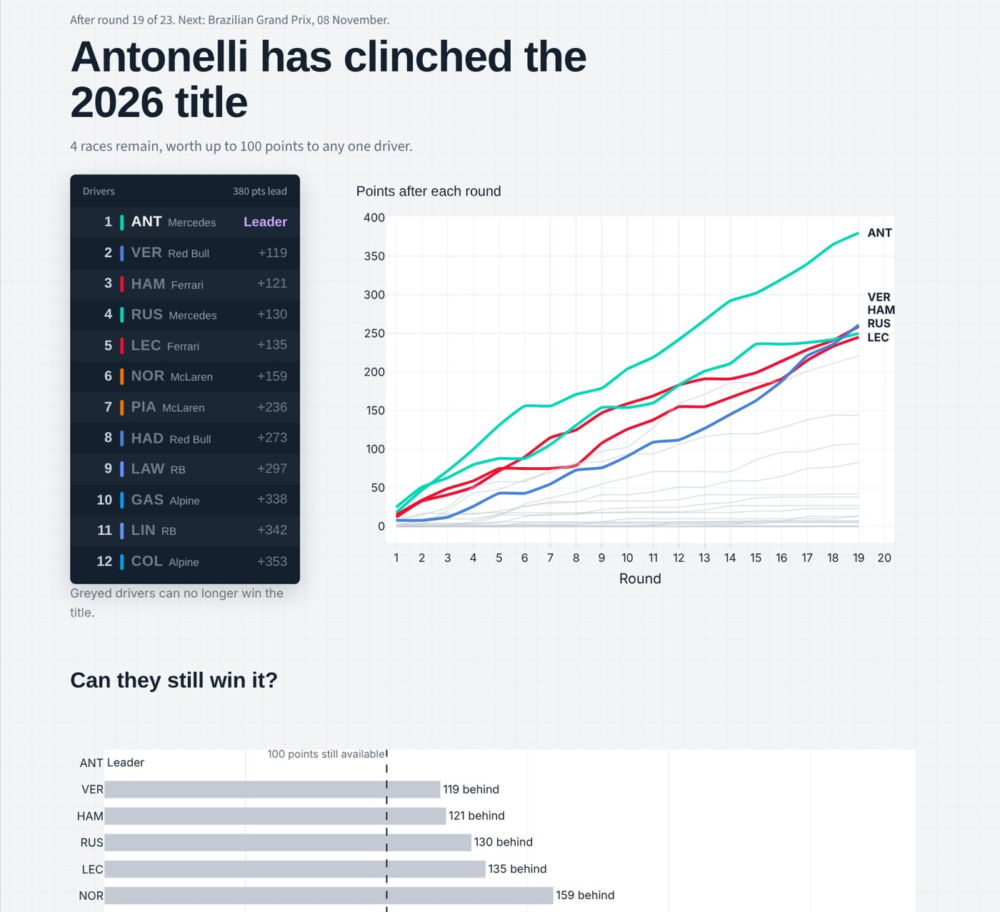
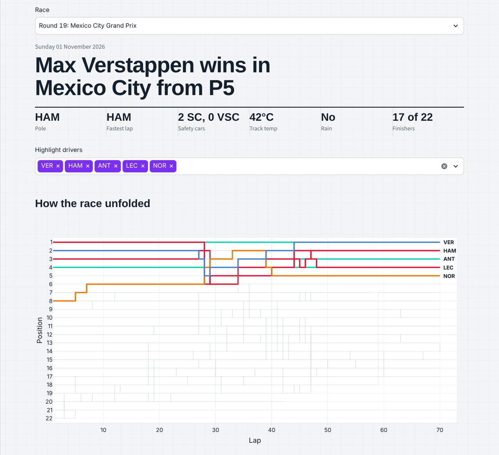
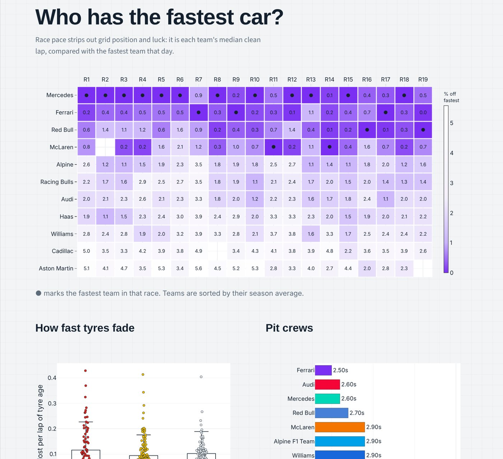
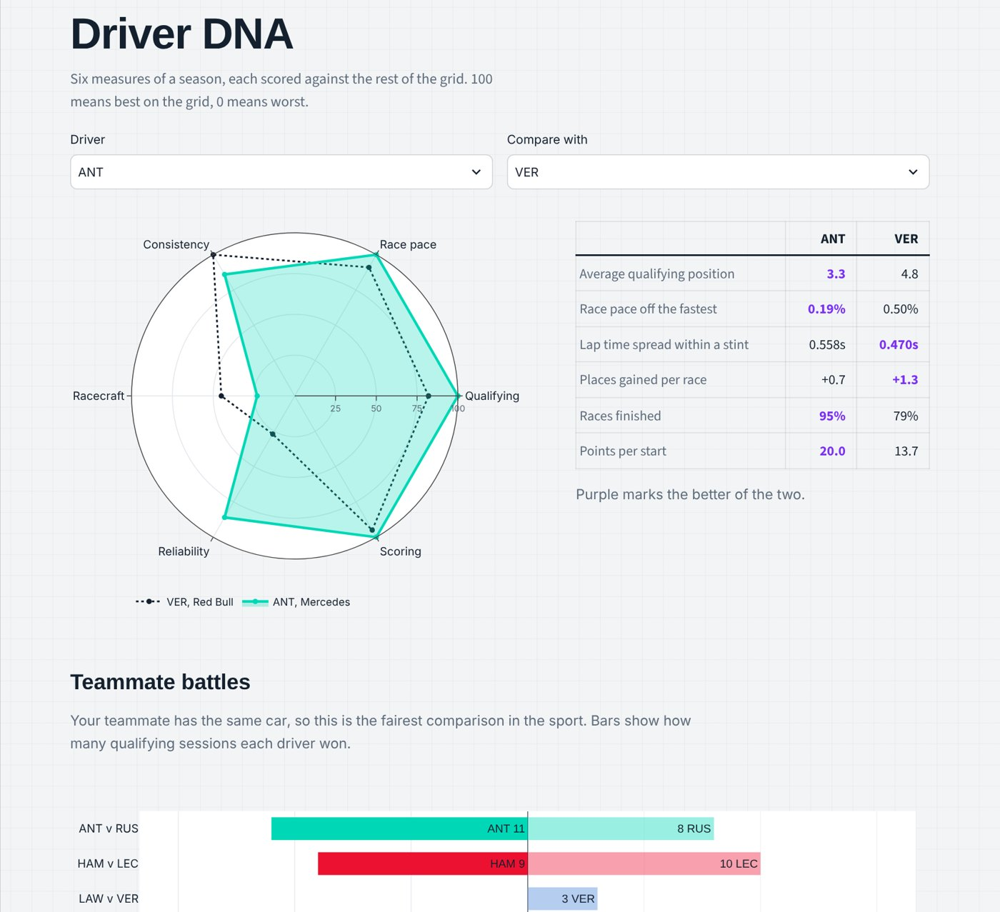
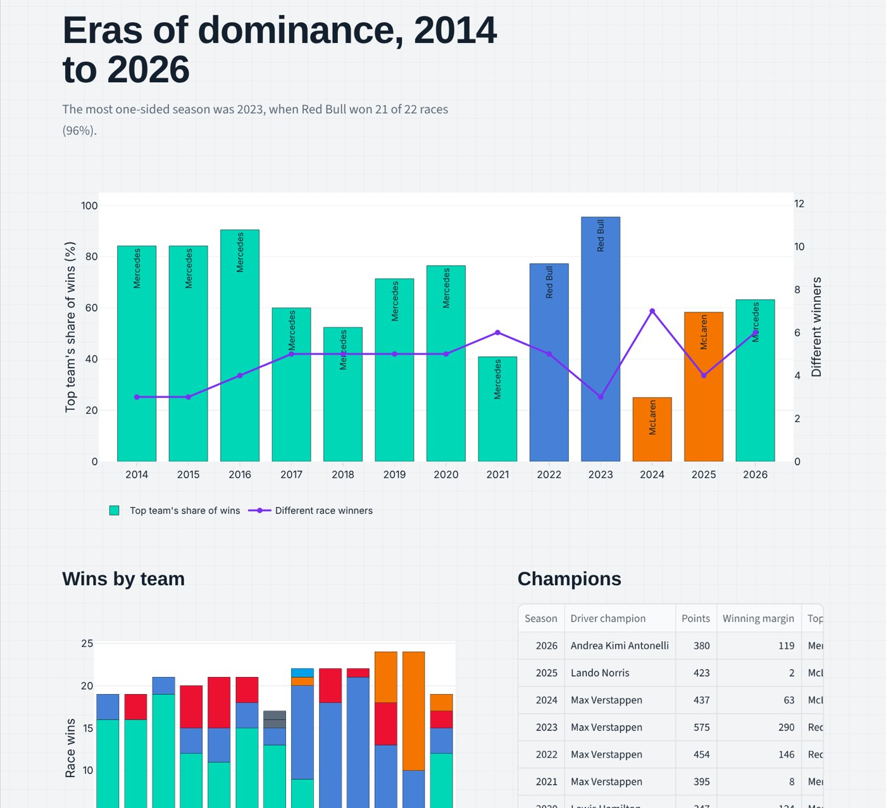
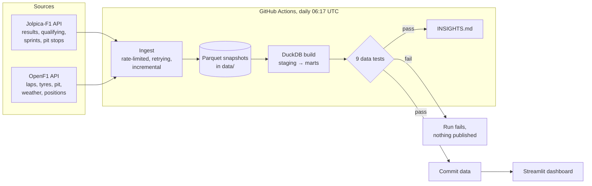

# PitWall

**Live Formula 1 race intelligence.** A daily pipeline pulls lap-by-lap timing, tyre, pit-stop and results data from two public F1 APIs into a tested DuckDB warehouse, and a Streamlit dashboard turns it into the story of the season.

[](https://github.com/AbdulSohail018/pitwall/actions/workflows/ci.yml)
[](https://github.com/AbdulSohail018/pitwall/actions/workflows/refresh.yml)




## What's inside

| | |
|---|---|
| **Live data** | Refreshed every morning by GitHub Actions from [OpenF1](https://openf1.org) and [Jolpica-F1](https://github.com/jolpica/jolpica-f1). Nothing is hand-edited. |
| **Scale** | 13 seasons (2014 onward), 271 Grands Prix, 5,500+ race results, plus ~25,000 timed laps, 1,400 tyre stints and 850 pit stops for the current season |
| **Warehouse** | DuckDB with layered SQL models: raw parquet → 12 staging models → 15 marts |
| **Data quality** | 9 SQL tests run on every refresh; a failing test blocks the data from being published |
| **Dashboard** | Six pages: Championship, Race Lab, Drivers, Teams, Eras, Method and data |
| **Analysis** | Title mathematics, fuel-corrected tyre degradation, race pace, teammate head-to-heads, a six-axis driver profile and era dominance |

## Findings from the 2026 season so far

_Snapshot from 7 November 2026, after round 19 of 23. [INSIGHTS.md](INSIGHTS.md) is regenerated with fresh numbers after every refresh._

- **The title is decided.** Andrea Kimi Antonelli leads Max Verstappen by 119 points with only 100 left on the table, so no one can catch him.
- **Mercedes has the fastest car, but not by much.** On race pace it was quickest in 12 of 19 races, yet only 0.17% clear of Ferrari on average. Red Bull was fastest in two of the last four races.
- **Teammate battles range from crushing to coin-flip.** Alonso out-qualified Stroll 15–2; Hamilton and Leclerc are split 9–10.
- **Pit crews are separated by tenths.** Ferrari has the quickest median pit-lane time (22.94 s); the median stationary time ranges from 2.5 s to 3.9 s across the grid.
- **History:** the most one-sided season since 2014 was 2023, when Red Bull won 21 of 22 races.

### A finding worth questioning

Measured degradation comes out *lower* for softs (0.062 s/lap) than hards (0.070 s/lap), the opposite of what tyre design implies. The likely cause is **selection bias**: teams run long soft stints only at tracks that are gentle on tyres, while hards get used where wear is brutal. A fair comparison needs to control for circuit, which is the next analysis on the roadmap. Each estimate comes from 119–176 stints of at least 8 clean, fuel-corrected laps.

## Screenshots

| Race Lab | Teams |
|---|---|
|  |  |
| **Drivers** | **Eras** |
|  |  |

## Architecture



**Ingestion** (`pitwall/ingest/`) respects each API's rate limit (OpenF1 allows 3 requests a second), honours `Retry-After` on HTTP 429, and is incremental. Finished seasons are fetched once, and each race session is fetched once and then re-checked for four days in case the data is corrected.

**Modelling** (`sql/`) is plain SQL in dependency order. Staging cleans and types the data and maps OpenF1 sessions to Jolpica rounds. Marts answer specific questions. `pitwall/warehouse.py` builds everything in memory in a few seconds.

## Data-quality tests

Each test in `sql/tests/` is a query that returns the rows breaking a rule. Zero rows means pass.

| Test | Rule |
|---|---|
| `points_reconcile_official` | Points computed from race and sprint results must exactly match the official standings |
| `results_unique` | Each driver appears once per Grand Prix |
| `results_not_null` | Every result has a driver, team, points and status |
| `grid_size` | Every Grand Prix has a full field |
| `sessions_map_to_rounds` | Every OpenF1 race session maps to a Jolpica round with results |
| `session_locations_match` | The mapped OpenF1 and Jolpica races are in the same place |
| `clean_laps_plausible` | No "clean" lap is under 55 s or over 180 s |
| `clean_laps_have_tyre` | At most 10% of clean laps per race are missing tyre data |
| `title_math_sane` | No negative gaps, and exactly one leader |

The reconciliation test earned its place during development: it caught drivers who had scored points but missed the latest race being dropped from the standings, and the points model was fixed to carry totals forward.

## Methods

- **Clean lap**: not lap 1, not a pit in- or out-lap, and within 107% of the race's quick laps (5th percentile). This removes safety-car laps, traffic and incidents.
- **Race pace**: a driver's median clean lap, as a percentage slower than the fastest driver in that race. Team pace uses the team's quicker car.
- **Fuel correction**: lap times are adjusted by 0.035 s for each lap of fuel still on board (`PITWALL_FUEL_CORRECTION`), so the falling fuel load doesn't hide tyre wear.
- **Tyre degradation**: the least-squares slope of fuel-corrected lap time against tyre age, per stint of 8+ clean laps, keeping fits with R² > 0.2.
- **Title contention**: a driver is still in it if winning every remaining race (25 points) and sprint (8) would bring them level with the leader's current total.
- **Driver DNA**: percentile ranks against every driver with 3+ starts this season, on qualifying, race pace, consistency, racecraft, reliability and scoring.

## Data dictionary (main marts)

| Mart | Grain | Used for |
|---|---|---|
| `mart_points_progression` | driver × round × season | Points race chart, standings |
| `mart_title_math` | driver (current season) | Timing tower, "can they still win it?" |
| `mart_driver_season` | driver × season | Scorecards, eras |
| `mart_constructor_season` | team × season | Constructors' table, wins by team |
| `mart_race_laps` | lap | Race Lab lap-time chart |
| `mart_race_pace` / `mart_team_pace` | driver or team × race | Pace ranking, pace heatmap |
| `mart_tyre_deg` | stint | Degradation by compound |
| `mart_stints` / `mart_positions` | stint / lap | Tyre strategy and position charts |
| `mart_teammate_h2h` | teammate pair | Head-to-head battles |
| `mart_driver_dna` | driver | Six-axis radar |
| `mart_pit_crew` | team | Pit-stop leaderboard |
| `mart_era` | season | Dominance across eras |
| `mart_race_conditions` | race session | Weather, safety cars, red flags |

## Run it yourself

```bash
git clone https://github.com/AbdulSohail018/pitwall.git
cd pitwall
python -m venv .venv && source .venv/bin/activate     # Windows: .venv\Scripts\activate
pip install -r requirements.txt

streamlit run app/streamlit_app.py      # dashboard, using the data already in the repo
python -m pitwall.refresh               # pull the latest data (about 10 minutes the first time)
python -m pitwall.warehouse --test      # build the warehouse and run the data tests
python -m pitwall.insights              # regenerate INSIGHTS.md
pytest                                  # unit tests on a synthetic season, no network needed
```

### Deploy the dashboard for free

1. Sign in at [share.streamlit.io](https://share.streamlit.io) with GitHub.
2. Choose **Create app**, select `AbdulSohail018/pitwall`, branch `main`, main file `app/streamlit_app.py`.
3. Deploy. The app redeploys automatically each time the daily refresh commits new data.

## Project layout

```
pitwall/
├── pitwall/            # ingestion, warehouse builder, insights generator
│   └── ingest/         # Jolpica and OpenF1 clients
├── sql/
│   ├── staging/        # 12 cleaning and mapping models
│   ├── marts/          # 15 analysis models
│   └── tests/          # 9 data-quality tests
├── app/                # Streamlit dashboard (streamlit_app.py, views/, lib.py)
├── data/               # parquet snapshots, refreshed daily
├── tests/              # unit tests with a synthetic season
└── .github/workflows/  # daily refresh and CI
```

## Credits

Data from [OpenF1](https://openf1.org) and [Jolpica-F1](https://github.com/jolpica/jolpica-f1), used under their public terms. PitWall is an unofficial fan project and is not associated in any way with the Formula 1 companies. F1, FORMULA ONE and related marks are trademarks of Formula One Licensing B.V.

## License

MIT
